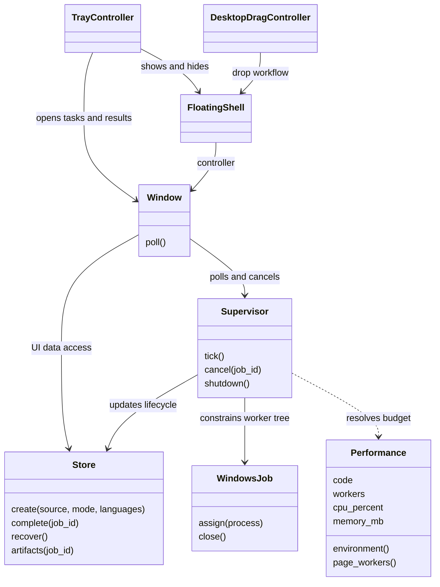
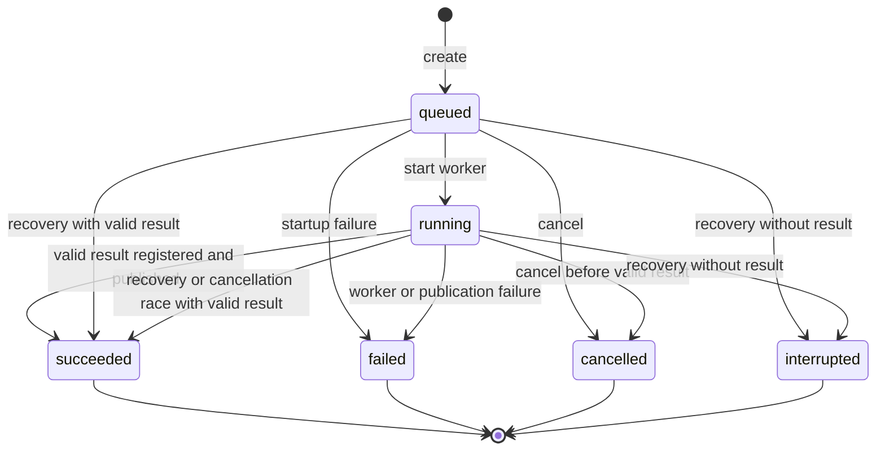
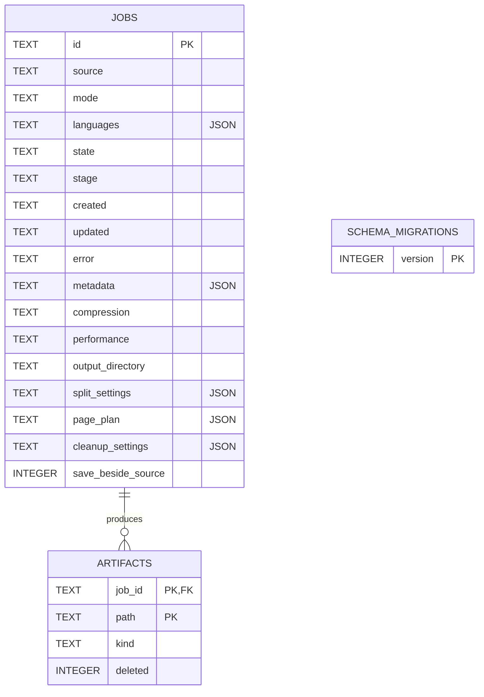

# Architecture and UML

Implementation reference for **0.27.0**. Mermaid diagrams render on GitHub and
show important relationships rather than every method.

## Component map

YuzuFile is a desktop application. Qt owns interaction, session-visible results,
SQLite, and the queue. One worker process handles one conversion attempt; native
inference can use additional helper processes managed within the worker tree.

All modules below are under `src/yuzufile/`.

| Responsibility | Modules |
| --- | --- |
| Entry points | `__main__.py`, `cli.py` |
| UI/controller | `ui.py`, `shaped_shell.py`, `tool_wheel.py`, `tool_window.py` |
| Desktop integration | `system_tray.py`, `desktop_drag.py`, `desktop_instance.py` |
| Visual editors | `organize_ui.py`, `merge_ui.py`, `cleanup_preview.py`, `spread_preview.py`, `page_canvas.py`, `page_grid.py`, `split_viewport.py` |
| Jobs | `supervisor.py`, `storage.py`, `worker.py`, `operations.py` |
| Page preparation/overlay | `ocr_clean.py`, `engines.py`, `unicode_overlay.py` |
| Recognition | `indra_engine.py`, `arabic_ocr.py`, `neural_text.py`, `neural_task.py`, `vision_runtime.py` |
| Export | `neural_markdown.py`, `word_export.py`, `word_mapping.py`, `word_rtl.py`, `word_detailed_ocr.py` |
| PDF transforms | `organize.py`, `spreads.py`, `cleanup.py`, `compression.py` |
| Output handling | `publication.py`, `output_names.py` |
| Resources | `performance.py`, `resources.py`, `windows_job.py`, `native_process.py` |

## Class relationships (UML)



The worker uses module-level functions, not a `Worker` class. `Window` combines
UI construction and application coordination; a separate service layer has not
yet been extracted. Method signatures above omit optional parameters.

## Conversion sequence (UML)

```mermaid
sequenceDiagram
    actor User
    participant UI as Qt controller
    participant DB as Store / SQLite
    participant S as Supervisor
    participant W as Worker process
    participant E as Local engines
    participant FS as Job files / destination
    User->>UI: Select PDFs, operations, options
    UI->>DB: create queued job
    UI->>S: tick()
    S->>DB: mark running
    S->>W: spawn; assign Windows Job; JSON stdin request
    W->>FS: snapshot input into staging
    W->>W: validate; apply requested page transforms
    opt OCR, Markdown, or Word requested
        loop One page at a time
            W->>E: render visible pixels; fresh recognition
            E-->>W: text, geometry, layout, warnings
            W->>FS: prepared page and recognition data
            opt Word requested
                W->>E: append editable Word page
            end
            W-->>S: JSON progress
            S->>DB: update stage
        end
    end
    W->>FS: outputs and manifest
    W->>FS: rename staging to result
    W-->>S: exit success
    S->>DB: complete(job_id)
    DB->>FS: validate artifacts; publish when needed
    DB->>DB: record artifacts and success
    UI->>DB: refresh current-session results
    UI-->>User: output actions and warnings
```

This is the success path. Stdout carries versioned JSON events; diagnostic output
must not corrupt the protocol. The reader thread only drains events, while the
main thread owns database writes. Word appends each page before requesting the
next. Combined exports reuse fresh recognition from the same attempt.

## Job lifecycle (UML)



Recovery with an unusable manifest marks the job failed. Retry creates a new
attempt/directory. Cancellation terminates the worker tree and cleans staging;
a valid completed result wins a cancellation race. A 24-hour supervisor timeout
fails unfinished work. Hiding a task window is distinct from quitting the app.

## Data model



The default store contains `history.sqlite3`, `instance.lock`, and
`library/<job-id>/` under `%LOCALAPPDATA%\YuzuFile`. Explicit destinations can hold
job folders outside this library. SQLite uses WAL and foreign keys. The database
name is historical; there is no History UI.

Each attempt writes `staging/`, then promotes it to `result/` after producing
`manifest.json`. The manifest records artifacts, provenance, warnings, and export
details. Publication has collision handling. Filesystem promotion and SQLite
commit are not a single cross-system transaction; recovery reconciles them.

## Resource policy

| Preset | Worker CPU cap | Worker memory budget | Thread/worker ceiling |
| --- | --- | --- | --- |
| Low usage | 25% | 2,048 MB | 1 |
| Balanced | 50% | 3,072 MB | 2 |
| High performance | 85% | 4,096 MB | 4 |

These are worker budgets, not total application RAM guarantees or quality levels.
The thread allowance is also bounded by CPU count. Fresh OCR stays sequential
across pages. Current raster input targets 300 dpi, capped at 8 million pixels.
Windows Job Objects and scoped library budgets reduce uncontrolled parallelism.

## Recognition boundaries

Indra supplies recognition/layout. Arabic print uses independent line detection
and Kraken PP-OCRv6 recognition through a pinned ONNX conversion, retaining
established Latin readings where applicable. RapidOCR and Tesseract provide
conditional fallback paths. This is not a majority vote over full transcripts.
Confidence scores are not accuracy guarantees.

Searchable PDF uses an invisible text overlay. Markdown and DOCX reconstruct
structure from recognition and geometry. Page rendering preserves appearance
but flattens native structure. Reading order, tables, and layout can differ.

## Safety boundaries and debt

- Conversion snapshots inputs and does not overwrite originals.
- Owned-path checks reject traversal, links, and Windows junctions in artifact paths.
- Process isolation/resource caps are not an OS security sandbox for malicious PDFs.
- Internal artifacts persist; no automatic retention expiry is promised.
- Controller extraction, clean-machine CI, complete license review, and a broad
  redistributable accuracy corpus remain future work.

See [decisions](DECISIONS.md), [security](../SECURITY.md), and
[release readiness](RELEASE_READINESS.md).
